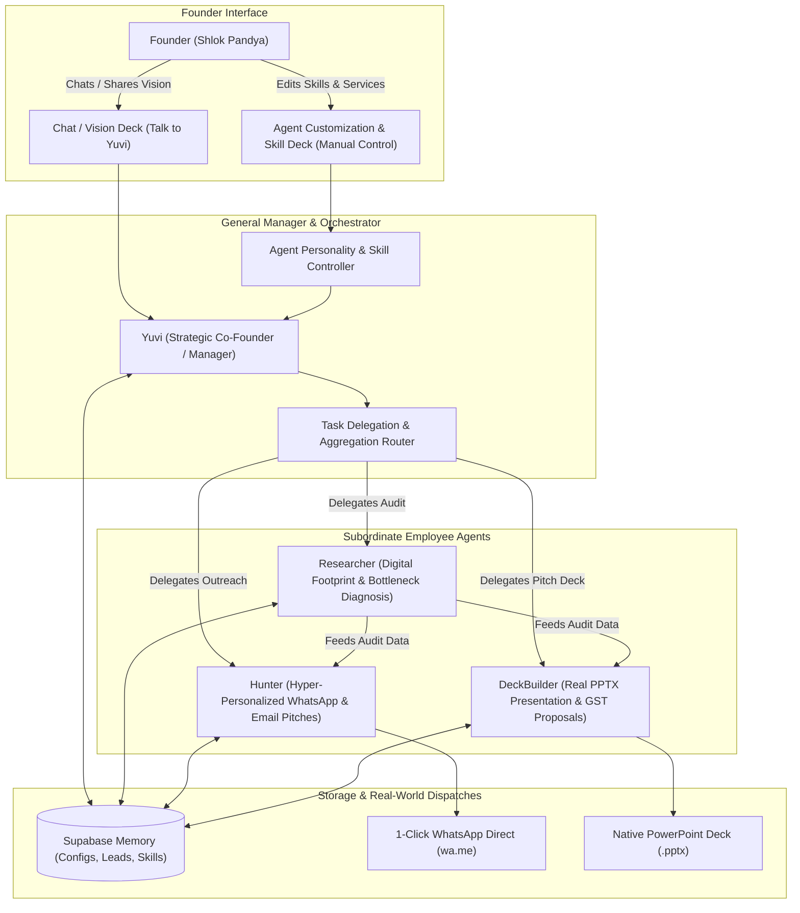
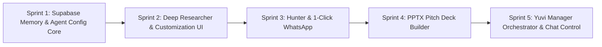

# YUVI: Master Engineering & Sprint Plan
## Autonomous AI Business Co-Founder & Revenue Engine for Yugantar Growth

> **Target Agency**: Yugantar Growth ([yugantar-growth-drab.vercel.app](https://yugantar-growth-drab.vercel.app))  
> **Founder**: Shlok Pandya (Ahmedabad, Gujarat)  
> **Core Offerings**: Fast Web Dev (48h, sub-2s load), Local SEO, AI WhatsApp Automation, Performance Ads, Brand Architecture  
> **Core Objective**: Transform YUVI into a real daily co-pilot that drives revenue, manages real outreach, generates client pitch decks/proposals, guides business vision, and allows full manual and conversational customization of its agent workforce.

---

## 1. Executive Summary: Manager-Employee Orchestration Architecture

The system follows a strict **Hierarchical Management Model**:
* **The Founder speaks ONLY to Yuvi (The General Manager & Strategic Co-Founder).**
* The Founder never needs to micromanage individual background agents.
* **Yuvi orchestrates the specialized employees** (Researcher, Hunter, DeckBuilder).
* **Dynamic Customization & Skill Adaptation**: Every agent (including Yuvi) has an editable configuration stored in Supabase/local memory. The founder can expand their capabilities in two ways:
  1. **Manually in the UI (Agent Customization Deck)**: Add new agency services, change focus criteria, adjust tone, or set pricing boundaries.
  2. **Conversationally via Yuvi**: Say in chat: *"Yuvi, we now offer AI Receptionist for luxury clinics at ₹35,000/mo. Update the Researcher's service catalog and teach Hunter the new pitch angle"*, and Yuvi updates the agent configuration and knowledge base in real-time.

---

## 2. Core Functional Pillars

### Pillar 1: Yuvi (Manager & Strategic Co-Founder)
* **The Single Point of Contact**: Founder talks only to Yuvi.
* **Daily Business Diagnostics**: Scans pipeline, detects uncontacted leads, flags overdue invoices, and prioritizes the day's high-margin tasks.
* **Vision & Strategy Advisory**: Stress-tests founder ideas against unit economics and cash flow.
* **Workforce Orchestration**: Deploys Researcher to audit leads, Hunter to draft pitches, and DeckBuilder to create proposals upon founder request.
* **Adaptive Memory**: When founder shares new insights or rules in chat, Yuvi records them into memory and updates subordinate agent criteria.

### Pillar 2: Agent Customization & Personalization System
Every agent has a live configuration object that controls:
1. **Mission & Role Objective**
2. **Focus Criteria & Boundaries**: e.g., target industry, geography, tone of voice, disqualification triggers.
3. **Service & Capability Catalog**: Dynamic list of services the agent can pitch or audit (e.g. Fast Websites, Local SEO, WhatsApp Automation, plus new services added on the fly).
4. **Knowledge Tags**: Rules and objections that this agent adheres to.
* Accessible via both **Agent Settings UI** and **natural language chat with Yuvi**.

### Pillar 3: Deep Lead Researcher (Subordinate Specialist)
* **Digital Footprint & Website Audit**: Inspects target website, page load speed, mobile layout, SSL, and conversion triggers.
* **Bottleneck Diagnosis**: Identifies revenue leaks (e.g., strong referral reputation but zero mobile lead capture).
* **Playbook Mapping**: Selects the matching Yugantar Growth service package and estimates ROI.
* **Output**: Stores verified claims and custom hooks directly on the lead record.

### Pillar 4: Hunter (Outreach & 1-Click WhatsApp Specialist)
* **Tailored Pitch Generation**: Crafts WhatsApp and Email messages infused with Researcher's audit findings.
* **1-Click WhatsApp Dispatch**: `https://wa.me/<phone>?text=<encoded_pitch>` opens WhatsApp Web/Desktop with the message ready to send.
* **Activity History**: Logs every dispatch automatically in lead telemetry.

### Pillar 5: DeckBuilder (Brahma-Style PPTX & Proposal Specialist)
* **Native PowerPoint Deck (`pptxgenjs`)**: Generates an 8-slide client pitch deck with Yugantar Growth branding (Gold/Dark theme), audit insights, solution architecture, and commercial investment.
* **Commercial Proposals with GST**: Pre-built quotations with itemized line items, automated 18% GST calculation, and printable/PDF export.

---

## 3. Sprint Execution Roadmap

### Sprint 1: Supabase Memory & Workspace Hygiene
* Prune unused 500MB `activepieces` clone and `brahma_reference` from git tracking.
* Connect Supabase Cloud PostgREST tables: `leads`, `client_accounts`, `proposals`, `agent_configs`, `knowledge_nodes`.
* Establish offline-first local cache for uninterrupted daily PWA usage.

### Sprint 2: Deep Lead Researcher & Agent Customization UI
* Build `lib/research/leadResearcher.ts`.
* Build Agent Customization Deck: Founder can view, tune, and expand skills/services for Yuvi, Researcher, Hunter, and DeckBuilder.
* Integrate "Run Deep Research" action in `LeadDetailModal.tsx`.

### Sprint 3: Hunter & 1-Click WhatsApp Dispatch
* Wire `ApprovalsView.tsx` and `LeadDetailModal.tsx` with direct `wa.me` links.
* Automatically encode Researcher findings into conversion-focused hooks.
* Real dispatch tracking in lead history.

### Sprint 4: Native PowerPoint Pitch Deck Builder (`pptxgenjs`)
* Install `pptxgenjs` in `artifacts/mockup-sandbox`.
* Build `lib/export/presentationBuilder.ts`.
* 1-Click download of editable `.pptx` presentations co-branded with Yugantar Growth & Target Lead.

### Sprint 5: Yuvi Manager Orchestrator & Conversational Control
* Enable Yuvi to parse natural language instructions to update agent capabilities (e.g. *"Yuvi, add AI Voice Agent service..."*).
* Implement morning revenue diagnostic brief in `ChatView.tsx`.
* Final production build, mobile PWA verification, and test suite execution.

---

## 4. Verification & Testing Plan

1. **Agent Customization**:
   - Add a new service (e.g., "AI Voice Booking") in the UI or via Chat -> verify Researcher immediately recognizes and pitches it in audits.
2. **Researcher Engine**:
   - Run audit on a lead -> verify verified claims, bottlenecks, and growth playbook are generated.
3. **1-Click WhatsApp**:
   - Click "Send via WhatsApp" -> verify WhatsApp Web/Desktop opens with pre-filled message.
4. **PowerPoint Presentation**:
   - Click "Build Pitch Deck" -> download `.pptx` -> verify slides open cleanly in PowerPoint/Keynote with agency styling and lead data.
5. **Build & Tests**:
   - `pnpm test` passes 100%.
   - `pnpm run build` succeeds with 0 errors.
